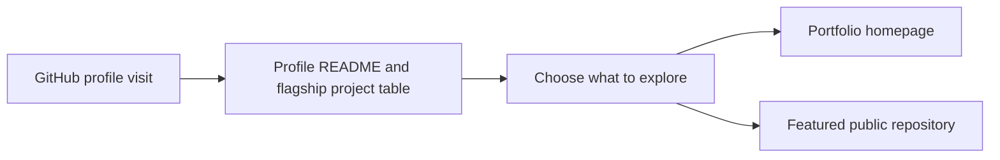

<h1 align="center">Lokesh Reddy</h1>
<h3 align="center">Site Reliability Engineer · Cloud Platforms · DevSecOps · AI for Operations</h3>

I build tools that help responders investigate incidents, recover services, and make safer release decisions.

  
  
  

## Selected Work

| Project | What you can verify |
| --- | --- |
| [SRE Incident Investigation Agent](https://github.com/Klokesh493/llm-sre-incident-investigation-agent) | Turn synthetic SLO and change evidence into a cited paging recommendation. Route incomplete evidence to an operator for review. [Captured model run](https://github.com/Klokesh493/llm-sre-incident-investigation-agent/blob/main/examples/live-report.json) |
| [SRE Error Budget Control Plane](https://github.com/Klokesh493/sre-error-budget-control-plane) | Replay SLO burn and test how Alertmanager routes page and ticket alerts and inhibits duplicate notifications. [Routing drill](https://github.com/Klokesh493/sre-error-budget-control-plane/blob/main/docs/RUNBOOK.md#verify-alertmanager-routing) |
| [Release Evidence Pipeline](https://github.com/Klokesh493/release-evidence-pipeline) | Reproduce an approved release and an incident hold using evidence from four SRE, AWS recovery, Azure ML, and on-call labs. [Release replay](https://github.com/Klokesh493/release-evidence-pipeline#run-the-demo) |
| [AWS Event Recovery Platform](https://github.com/Klokesh493/aws-event-recovery-platform) | Retry only failed SQS records, preserve idempotent receipts, and exercise the dead-letter recovery path locally. [Recovery drill](https://github.com/Klokesh493/aws-event-recovery-platform#run-the-demo) |
| [Kubernetes Node Drain Planner](https://github.com/Klokesh493/kubernetes-node-drain-planner) | Check workload replicas, disruption budgets, and critical pods before planning a node drain. [Run the planner](https://github.com/Klokesh493/kubernetes-node-drain-planner#run-the-project) |
| [Azure ML Endpoint Release Lab](https://github.com/Klokesh493/azure-ml-endpoint-release-lab) | Train a classifier, verify holdout quality and the model artifact, then replay the Azure ML scoring contract locally. [Scoring demo](https://github.com/Klokesh493/azure-ml-endpoint-release-lab#run-the-demo) |

## AI Agent Labs

The labs use a local Qwen model to select read-only evidence probes. Each report records the input evidence and the resulting policy decision on synthetic data.

| Lab | What you can verify |
| --- | --- |
| [Dependency Remediation](https://github.com/Klokesh493/ai-dependency-remediation-agent) | Review an advisory and identify a candidate update outside the affected version range. The report records whether it qualifies for testing. [Model report](https://github.com/Klokesh493/ai-dependency-remediation-agent/blob/main/examples/live-report.json) |
| [AI Release Regression](https://github.com/Klokesh493/ai-release-regression-agent) | Use evaluation evidence to recommend a release decision. Critical regressions, unsupported citations, and token overruns trigger a hold. [Model report](https://github.com/Klokesh493/ai-release-regression-agent/blob/main/examples/live-report.json) |
| [Model Drift Investigation](https://github.com/Klokesh493/ai-model-drift-investigation-agent) | Investigate drift with feature shift, label quality, and freshness evidence before proposing a follow-up. [Model report](https://github.com/Klokesh493/ai-model-drift-investigation-agent/blob/main/examples/live-report.json) |
| [Support Knowledge](https://github.com/Klokesh493/ai-support-knowledge-agent) | Return a cited support excerpt from the appropriate tenant or escalate with the reason recorded. [Model report](https://github.com/Klokesh493/ai-support-knowledge-agent/blob/main/examples/live-report.json) |

## Professional Summary

I focus on the decisions engineers make during incidents and changes. My projects turn SLOs into routing decisions, evaluate rollout and recovery evidence, and give responders a cited next step. The repositories document how to run each demo, test failure cases, and understand the limits of the result.

## Tech Stack

### DevOps and CI/CD

   

### Cloud, Platform, and Security

    

### DevSecOps Tooling

    

Tool references for container scanning, secret detection, secrets management, infrastructure policy, and artifact signing. For a portfolio example, see the [Immutable Backup Policy Auditor](https://github.com/Klokesh493/immutable-backup-policy-auditor).

### Monitoring, SRE, and On-call

       

### Streaming, AI, and ML

    

### Service and Support Domains

SaaS means Software as a Service.

## More Engineering Work

- [Splunk Alert Triage](https://github.com/Klokesh493/splunk-alert-triage) · Deduplicate exported alerts and prioritize on-call review.
- [Kafka Consumer Lag SLO Guard](https://github.com/Klokesh493/kafka-consumer-lag-slo-guard) · Estimate catch-up time against a freshness objective.
- [On-call Rotation Lab](https://github.com/Klokesh493/on-call-rotation-lab) · Simulate coverage, acknowledgment deadlines, and escalation.
- [Multi-Region Failover Planner](https://github.com/Klokesh493/multi-region-failover-planner) · Evaluate target health, capacity, and replication lag.

## Currently Learning

- Evaluating agent decisions when telemetry is incomplete, conflicting, or stale.
- Diagnosing Kafka consumer lag and recovering safely across partitions.
- Comparing model candidates with reproducible scoring and drift evidence.

## What I Bring

- **Incident readiness** · On-call coverage, clear escalations, and evidence that a responder can reproduce.
- **Platform operations** · Kubernetes maintenance checks, release holds, and recovery drills.
- **AI-assisted workflows** · Cited evidence, escalation paths, and operational decisions reviewable by an engineer.

## Connect

[Portfolio](https://klokesh493.github.io/lokesh-kalluru-portfolio/) · [GitHub activity](https://github.com/Klokesh493#js-contribution-activity) · [All repositories](https://github.com/Klokesh493?tab=repositories)

About this profile repository

## Business problem

Reviewers need a direct route from the profile to runnable engineering work and its verification evidence.

## What I built

This repository is the source of my GitHub Overview. I organized the README around selected SRE and platform projects, then linked each entry to the public repository so reviewers can see the code, an example, and its verification evidence. GitHub renders the Markdown and HTML, and Shields.io supplies the navigation badges.

## Project walkthrough

[Architecture and data flow](docs/ARCHITECTURE.md) · [Business problem, demo, and verification](docs/CASE_STUDY.md)

## Run the project

Open the public GitHub profile, then follow a featured project link or the portfolio button.

Read the [architecture](docs/ARCHITECTURE.md) and [walkthrough](docs/CASE_STUDY.md) for the source path and verification scope.

[Development and review](docs/DEVELOPMENT.md)

## Runbook

[Run, verify, and troubleshoot this project](docs/RUNBOOK.md)

[Skills and verification](docs/ENGINEERING_NOTES.md)
