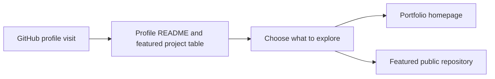

<h1 align="center">Lokesh Reddy</h1>
<h3 align="center">Site Reliability Engineer | Cloud Platforms | DevSecOps | MLOps</h3>

I build tools for service reliability, platform operations, and incident response.

  

## Featured SRE and Platform Projects

| Project | What it demonstrates |
| --- | --- |
| [Kubernetes Node Drain Planner](https://github.com/Klokesh493/kubernetes-node-drain-planner) | Check replica counts, pod disruption budgets, and critical workloads before draining a node. |
| [Multi-Region Failover Planner](https://github.com/Klokesh493/multi-region-failover-planner) | Choose a failover region using health, available capacity, and replication lag. |
| [API Latency SLO Sentinel](https://github.com/Klokesh493/api-latency-slo-sentinel) | Check p95 and p99 API latency against service objectives. |
| [Splunk Alert Triage](https://github.com/Klokesh493/splunk-alert-triage) | Deduplicate exported alerts and prioritize services for on-call review. |
| [Kafka Consumer Lag SLO Guard](https://github.com/Klokesh493/kafka-consumer-lag-slo-guard) | Estimate whether Kafka consumer groups can catch up within a freshness SLO. |
| [On-call Runbook Retriever](https://github.com/Klokesh493/on-call-runbook-retriever) | Suggest a cited runbook for matching incident symptoms and request review for weak or tied matches. |

## Professional Summary

I build and document tools for operating cloud platforms and ML systems. My projects focus on the decisions engineers make during a rollout, an incident, or planned maintenance: what to measure, when to intervene, and how to make the next action clear.

## Professional Snapshot

- **Site reliability** · Latency and freshness SLOs, incident triage, and failover readiness
- **Cloud and platform** · Kubernetes disruption controls, streaming operations, and release gates
- **Secure delivery** · Release checks and backup policy review
- **MLOps** · Model-serving canaries and streaming data validation

## Tech Stack

### DevOps and CI/CD

   

### Cloud, Platform, and Security

    

### DevSecOps Tooling

    

Tool references for container scanning, secret detection, secrets management, infrastructure policy, and artifact signing. For a portfolio example, see the [Immutable Backup Policy Auditor](https://github.com/Klokesh493/immutable-backup-policy-auditor).

### Monitoring, SRE, and On-call

       

### Streaming, AI, and ML

    

### Service and Support Domains

SaaS means Software as a Service.

## DevOps and AI Focus

- **Release safety** · Compare a rollout with its baseline before increasing traffic.
- **Incident response** · Correlate operational signals and use service objectives to guide triage.
- **Platform operations** · Plan node maintenance and review recovery controls before they are needed.

## Currently Learning

- Kafka administration: topic settings, consumer groups, and lag diagnosis.
- On-call operations: shift handoffs, acknowledgment deadlines, and escalation policies.
- AI agent evaluation: cited runbooks, abstention when evidence is missing, and human approval for operational changes.
- MLOps: model promotion, canary evaluation, and drift signals.

## More Engineering Projects

- [On-call Rotation Lab](https://github.com/Klokesh493/on-call-rotation-lab) simulates shift coverage and escalation deadlines.
- [Production Release Readiness](https://github.com/Klokesh493/production-release-readiness) checks rollback drills, ownership, and remaining error budget.
- [Immutable Backup Policy Auditor](https://github.com/Klokesh493/immutable-backup-policy-auditor) reviews backup immutability, retention, and encryption.
- [Model Serving Canary Analyzer](https://github.com/Klokesh493/model-serving-canary-analyzer) compares baseline and canary signals before expanding model traffic.

## Future Projects

| Project | Planned scope |
| --- | --- |
| Kafka Operations Lab | Run a local cluster and diagnose consumer lag and partition skew. |
| On-call Triage Agent | Summarize alert evidence and cite runbooks for responder review. |
| ML Release Pipeline | Gate model promotion on reproducible evaluation and rollback criteria. |
| Prometheus On-call Lab | Test alert rules, routing, and escalation with synthetic incidents. |

## GitHub Stats

[Contribution activity](https://github.com/Klokesh493#js-contribution-activity) · [All repositories](https://github.com/Klokesh493?tab=repositories)

## What I Bring

- I turn reliability questions into concrete checks, from rollout comparisons to backup policy audits.
- I connect infrastructure, observability, and ML serving so an operator can see what changed and decide what to do next.
- I document how to reproduce a result and where a lab's assumptions stop applying.

## Connect with Me

[Portfolio](https://klokesh493.github.io/lokesh-kalluru-portfolio/index.html?view=operations) · [Selected work](https://klokesh493.github.io/lokesh-kalluru-portfolio/index.html?view=operations#work) · [Lab roadmap](https://klokesh493.github.io/lokesh-kalluru-portfolio/index.html?view=operations#labs) · [Engineering tools](https://klokesh493.github.io/lokesh-kalluru-portfolio/index.html?view=operations#tools)

## Open To

Site Reliability Engineering · DevOps and Cloud Platform Engineering · DevSecOps · MLOps and AI Platform Engineering

## Business problem

Reviewers need a direct route from the profile to runnable engineering work and its verification evidence.

## What I built

This repository is the source of my GitHub Overview. I organized the README around selected SRE and platform projects, then linked each entry to the public repository so reviewers can see the code, an example, and its verification evidence. GitHub renders the Markdown and HTML, and Shields.io supplies the navigation badges.

## Project walkthrough

[Architecture and data flow](docs/ARCHITECTURE.md) · [Business problem, demo, and verification](docs/CASE_STUDY.md)

## Run the project

Open the public GitHub profile, then follow a featured project link or the portfolio button.

Read the [architecture](docs/ARCHITECTURE.md) and [walkthrough](docs/CASE_STUDY.md) for the source path and verification scope.

[Development and review](docs/DEVELOPMENT.md)

## Runbook

[Run, verify, and troubleshoot this project](docs/RUNBOOK.md)
