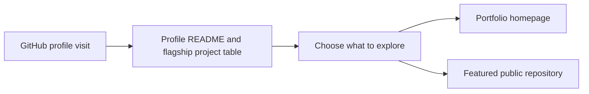

<h1 align="center">Lokesh Reddy</h1>
<h3 align="center">Site Reliability Engineer · Cloud Platforms · DevSecOps · AI for Operations</h3>

I build AI-assisted platforms for incident response, accelerator capacity, secure delivery, and self-service infrastructure.

  
  
  

## Selected Work

Five standalone platforms combine domain-specific policy, bounded AI evidence collection, authenticated APIs, persistent approval workflows, and observability. Each repository includes architecture diagrams, a quick start, failure tests, captured local model runs, and an operations runbook.

| Project | What it demonstrates | Verification |
| --- | --- | --- |
| [AI SRE Incident Command](https://github.com/Klokesh493/ai-sre-incident-command-platform) | Correlate complete SLO windows with Splunk evidence, resolve the current responder, and export a reviewed escalation payload. | [Evidence](https://github.com/Klokesh493/ai-sre-incident-command-platform/blob/main/docs/VALIDATION.md) |
| [AI Accelerator Capacity Platform](https://github.com/Klokesh493/ai-accelerator-capacity-platform) | Reserve inference replicas using GPU memory, benchmark freshness, latency headroom, and hourly budget constraints. | [Evidence](https://github.com/Klokesh493/ai-accelerator-capacity-platform/blob/main/docs/VALIDATION.md) |
| [AI Delivery Pipeline Orchestrator](https://github.com/Klokesh493/ai-delivery-pipeline-orchestrator) | Check pipeline dependencies and artifact integrity, then hold releases on failed prerequisites or canary regressions. | [Evidence](https://github.com/Klokesh493/ai-delivery-pipeline-orchestrator/blob/main/docs/VALIDATION.md) |
| [AI DevSecOps Exposure Platform](https://github.com/Klokesh493/ai-devsecops-exposure-platform) | Trace vulnerable packages through the dependency graph and check waiver expiry before approving a security review. | [Evidence](https://github.com/Klokesh493/ai-devsecops-exposure-platform/blob/main/docs/VALIDATION.md) |
| [AI Self-Service Platform Control Plane](https://github.com/Klokesh493/ai-self-service-platform-control-plane) | Validate service ownership, image digests and tenant quotas, then export hardened Kubernetes manifests. | [Evidence](https://github.com/Klokesh493/ai-self-service-platform-control-plane/blob/main/docs/VALIDATION.md) |

## Professional Focus

I focus on the decisions engineers make during incidents and changes. My projects connect measurable evidence to a reviewed action, from SLO burn and dependency exposure to inference capacity and Kubernetes service requests. I document the setup, tradeoffs, validation results, and remaining integration work so another engineer can reproduce the result.

## Tech Stack

### Reliability and On-call

    

SLO windows, on-call coverage, incident correlation, audit delivery, and escalation payloads.

### AI and Platform Engineering

    

Local Qwen inference, constrained tool loops, GPU capacity planning, service catalogs, and quota-aware manifest generation.

### DevOps and DevSecOps

   

Pipeline dependency checks, artifact hashes, canary gates, normalized scanner exports, and expiring security waivers.

## Cloud and Engineering Foundations

| Project | Focus |
| --- | --- |
| [Release Evidence Pipeline](https://github.com/Klokesh493/release-evidence-pipeline) | Integrated SRE, AWS recovery, Azure ML and on-call replay gates |
| [SRE Error Budget Control Plane](https://github.com/Klokesh493/sre-error-budget-control-plane) | Prometheus burn alerts and a local Alertmanager routing drill |
| [AWS Event Recovery Platform](https://github.com/Klokesh493/aws-event-recovery-platform) | SQS partial retries, idempotency and Terraform deployment assets |
| [Azure ML Endpoint Release Lab](https://github.com/Klokesh493/azure-ml-endpoint-release-lab) | Synthetic training, artifact quality gates and local scoring |
| [Kafka Consumer Lag SLO Guard](https://github.com/Klokesh493/kafka-consumer-lag-slo-guard) | Consumer catch-up estimates and freshness objectives |

## Focused AI Labs

[Incident investigation](https://github.com/Klokesh493/llm-sre-incident-investigation-agent) · [Dependency remediation](https://github.com/Klokesh493/ai-dependency-remediation-agent) · [Release evaluation](https://github.com/Klokesh493/ai-release-regression-agent) · [Support knowledge](https://github.com/Klokesh493/ai-support-knowledge-agent) · [Model drift](https://github.com/Klokesh493/ai-model-drift-investigation-agent)

## What I Bring

- **Reliability engineering** · Complete evidence windows, clear ownership, and failure paths that a responder can reproduce.
- **Platform design** · Strict API contracts, persistent workflows, retry handling, and version-checked approvals.
- **AI evaluation** · Real local model traces, deterministic policy checks, and explicit handling of missing evidence.

## Connect

[Portfolio](https://klokesh493.github.io/lokesh-kalluru-portfolio/) · [Selected work](https://klokesh493.github.io/lokesh-kalluru-portfolio/#work) · [GitHub activity](https://github.com/Klokesh493#js-contribution-activity) · [All repositories](https://github.com/Klokesh493?tab=repositories)

About this profile repository

## Business problem

Reviewers need a direct route from the profile to runnable engineering work and its verification evidence.

## What I built

This repository is the source of my GitHub Overview. I organized the README around selected SRE and platform projects, then linked each entry to the public repository so reviewers can see the code, an example, and its verification evidence. GitHub renders the Markdown and HTML, and Shields.io supplies the navigation badges.

## Project walkthrough

[Architecture and data flow](docs/ARCHITECTURE.md) · [Business problem, demo, and verification](docs/CASE_STUDY.md)

## Run the project

Open the public GitHub profile, then follow a featured project link or the portfolio button.

Read the [architecture](docs/ARCHITECTURE.md) and [walkthrough](docs/CASE_STUDY.md) for the source path and verification scope.

[Development and review](docs/DEVELOPMENT.md)

## Runbook

[Run, verify, and troubleshoot this project](docs/RUNBOOK.md)

[Skills and verification](docs/ENGINEERING_NOTES.md)
