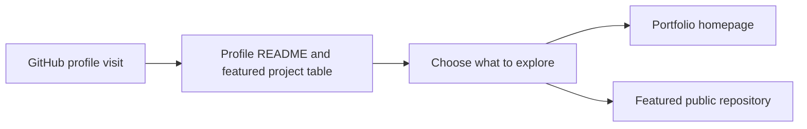

# Klokesh493 architecture

Give reviewers a path from the GitHub profile to the portfolio and featured projects.

## Operational boundaries

Profile content is Markdown and badge links. GitHub renders it from the profile repository.
